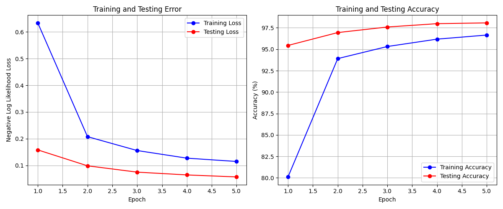
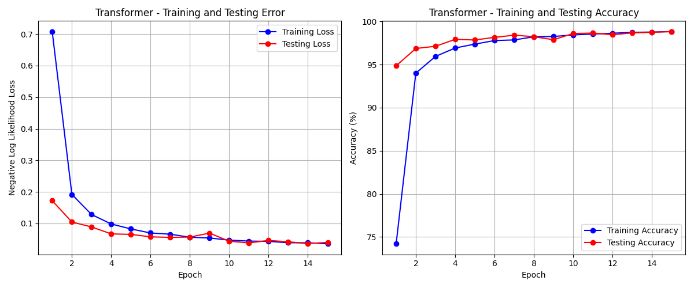
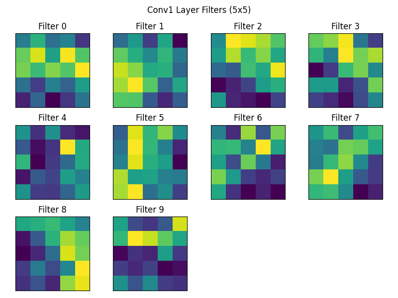
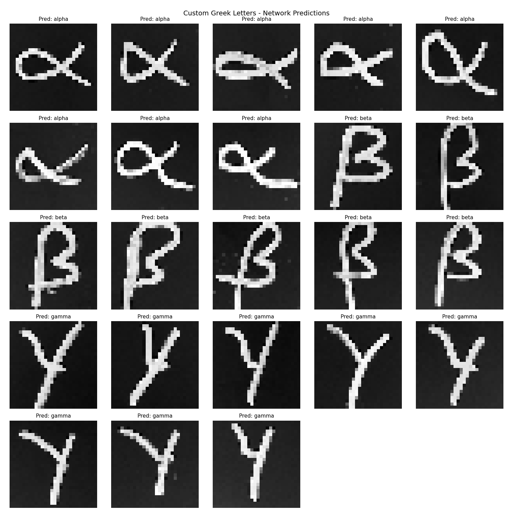
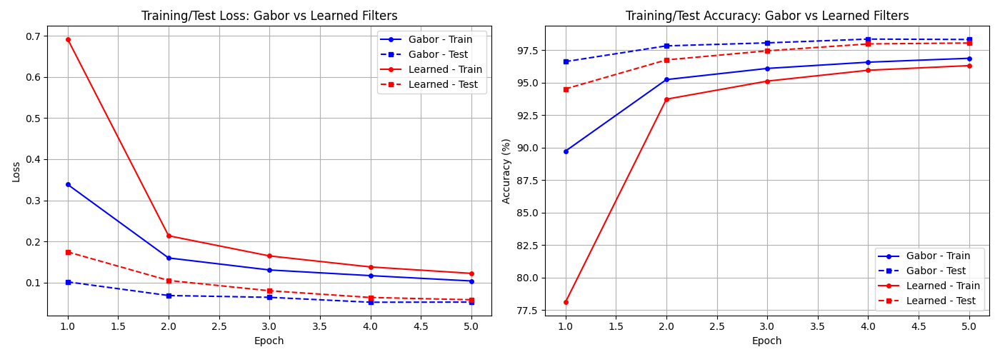

# Handwritten Character Recognition with CNNs and Vision Transformers

A PyTorch exploration of deep networks for recognizing handwritten characters.
It trains a CNN on MNIST and looks inside it, then reuses that network to learn
Greek letters from only 27 examples. It also compares learned filters with
hand-crafted Gabor filters, and builds a Vision Transformer from scratch with an
automated architecture search on Fashion-MNIST.

## Highlights

| Experiment                                       | Result                                                        |
| ------------------------------------------------ | ------------------------------------------------------------- |
| CNN on MNIST (5 epochs)                          | ~98% test accuracy                                            |
| Vision Transformer on MNIST (15 epochs)          | ~98.8% test accuracy                                          |
| Transfer learning to Greek letters (α, β, γ)     | 23/23 correct on new handwritten samples                      |
| Frozen Gabor first layer vs. learned first layer | Gabor network matches or beats the learned one at every epoch |

<p align="center">
  
  
</p>

## Project structure

```
├── src/          # all scripts
├── models/       # pretrained weights (.pth)
├── samples/      # handwritten test and training images
│   ├── digits/          # 10 digits (0–9) for testing the CNN
│   ├── greek_train/     # 27 training images (9 each of alpha, beta, gamma)
│   └── greek_custom/    # 23 new Greek letters for testing
├── results/      # result plots shown in this README
└── outputs/      # plots generated when you run the scripts (not tracked)
```

| Script                              | What it does                                                                                                |
| ----------------------------------- | ----------------------------------------------------------------------------------------------------------- |
| `src/mnist_recognition.py`          | Defines and trains the CNN (`MyNetwork`) on MNIST, plots loss and accuracy curves, saves `mnist_model.pth`  |
| `src/evaluate_model.py`             | Loads the trained CNN and shows its outputs and predictions for the first test images                       |
| `src/test_custom_digits.py`         | Runs the CNN on your own handwritten digit photos (defaults to `samples/digits/`)                           |
| `src/examine_network.py`            | Prints the architecture, plots the 10 learned conv1 filters, and applies them to a digit with OpenCV        |
| `src/greek_recognition.py`          | Transfer learning: freezes the MNIST CNN, swaps in a 3-class head, and trains it on `samples/greek_train/`  |
| `src/gabor_extension.py`            | Replaces conv1 with a fixed bank of Gabor filters and compares it with a fully learned network              |
| `src/examine_pretrained_network.py` | Shows the filters, filter effects and activations of the first layers of an ImageNet-pretrained VGG16       |
| `src/mnist_transformer.py`          | Vision Transformer built from scratch (patch embedding, positional encoding, encoder stack, MLP head)       |
| `src/mnist_experiment.py`           | Automated search over ViT depth, embedding size and number of heads on Fashion-MNIST                        |

Pretrained weights for all four models are included in `models/`, so you can run the
evaluation scripts without training first.

## Getting started

```bash
git clone https://github.com/Furqan2001/handwriting-recognition-cnn-vit.git
cd handwriting-recognition-cnn-vit
python -m venv .venv && source .venv/bin/activate
pip install -r requirements.txt
```

MNIST and Fashion-MNIST download automatically to `./data` the first time you run a script.

## Usage

Run every script from the repository root. Plots are saved to `outputs/` and trained
models to `models/`.

```bash
# Train the CNN (writes models/mnist_model.pth)
python src/mnist_recognition.py

# Evaluate it and look inside
python src/evaluate_model.py
python src/examine_network.py
python src/test_custom_digits.py [image_dir]        # default: samples/digits/

# Transfer learning to Greek letters (needs models/mnist_model.pth)
python src/greek_recognition.py [train_dir] [test_dir]   # defaults: samples/greek_train/ samples/greek_custom/

# Gabor filters vs. learned filters
python src/gabor_extension.py

# Pretrained VGG16 filters and activations
python src/examine_pretrained_network.py

# Vision Transformer
python src/mnist_transformer.py
python src/mnist_experiment.py      # long run: many ViT trainings on Fashion-MNIST
```

To test your own images, use dark ink on a light background. The scripts convert each image
to grayscale, resize it to 28×28, and invert it to match the MNIST format. For
`test_custom_digits.py`, include the digit in the filename (e.g. `digit_7.png`) and the plot
will mark each prediction right or wrong.

## Details

### CNN

```
Conv(1→10, 5×5) → MaxPool(2) → ReLU
Conv(10→20, 5×5) → Dropout(0.5) → MaxPool(2) → ReLU
Flatten(320) → Linear(50) → ReLU → Linear(10) → LogSoftmax
```

It trains for 5 epochs with SGD (lr 0.01, momentum 0.5).

<p align="center"></p>

### Transfer learning to Greek letters

All of the MNIST network's weights are frozen and only a new final layer (50 → 3) is trained.
Training stops early once it gets every training example right. On 23 handwritten letters it
had never seen, it classified all 23 correctly.

<p align="center"></p>

### Gabor filters vs. learned filters

The first layer is replaced by 10 fixed 5×5 Gabor filters (5 orientations × 2 frequencies),
and the rest of the network is trained as usual. The fixed Gabor network converges faster and
ends slightly ahead of the network that learns all its filters (~98.3% vs. ~98.1% test
accuracy after 5 epochs).

<p align="center"></p>

### Vision Transformer

Overlapping 4×4 patches (stride 2) are embedded into 48 dimensions, with learned positional
encodings, followed by 4 encoder layers with 8 attention heads, mean pooling, and an MLP
classifier. It trains with AdamW (lr 1e-3, weight decay 1e-4) for 15 epochs. All settings are
in `NetConfig` in `mnist_transformer.py`.

`mnist_experiment.py` tunes the architecture on Fashion-MNIST, which is harder than MNIST. It
tunes one setting at a time while holding the others at their best values so far, and makes
several passes:

- depth: 1, 2, 4, 6, 8
- embedding size: 24, 48, 96, 128, 192
- attention heads: 1, 2, 4, 8, 12

It writes per-setting plots, training curves, a summary figure, and `experiment_results.csv`.

## Author

Furqan Abid
